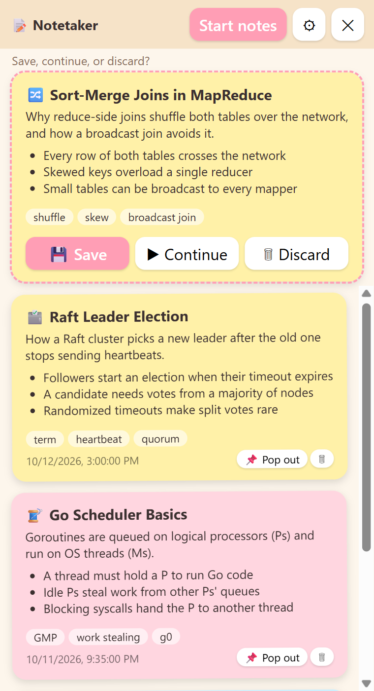

# Notetaker

Press a hotkey and Notetaker watches your screen and makes sticky-note summaries. It runs in the background, and its window is hidden from screen sharing and screenshots.



*Example notes shown above are made up for the screenshot.*

- `Ctrl+Shift+S` (`Cmd+Shift+S` on Mac): start taking notes
- `Ctrl+Shift+E` (`Cmd+Shift+E`): stop. A draft note pops up with **Save / Continue / Discard**
- `Ctrl+Shift+H` (`Cmd+Shift+H`): show or hide the window
- `Ctrl+Shift+Q` (`Cmd+Shift+Q`): quit

Notes are stored only on your computer. **Settings → Export backup** saves them as a JSON file.

## Install

Download the installer for your system from the [Releases page](../../releases):

| System | File |
|---|---|
| Windows | `Notetaker Setup x.y.z.exe` |
| macOS (Apple Silicon only, M1 or later) | `Notetaker-x.y.z-arm64.dmg` |
| Linux | `Notetaker-x.y.z.AppImage` |

The installers are **not code-signed**, so expect warnings:
- **Windows:** SmartScreen says "Windows protected your PC". Click *More info → Run anyway*. Some managed or Smart App Control setups block unsigned apps entirely.
- **macOS:** right-click the app → *Open* the first time. You must also allow *Screen Recording* in System Settings → Privacy & Security.

## Choose how notes are made

Open ⚙ Settings.

- **Local (Ollama), the default:** nothing leaves your computer. Install [Ollama](https://ollama.com), then run `ollama pull qwen2.5vl:3b`. Without a GPU this is slow: expect a few minutes for a draft after you stop.
- **Claude API:** faster and better, but every captured screenshot is sent to Anthropic. Needs your own API key, stored encrypted on your machine.

Screenshots are never written to disk. Only the generated note text is saved.

## Platform status

| Platform | Status |
|---|---|
| Windows 11 | Developed and tested here |
| macOS | Written but **untested**, and the download is Apple Silicon only (no Intel build). Newer macOS versions may not honor the screen-share hiding for some capture apps |
| Linux | **Untested**. Global hotkeys and screen capture do not work on Wayland, and window hiding is not supported |

The hiding stops software capture only. A camera pointed at your screen still sees it.

## Responsible use

Don't use this to break the rules of an exam, interview, or workplace. Check what's allowed before using any hidden tool in a shared or monitored setting.

## Run from source

```
git clone https://github.com/abinashstack/notetaker.git
cd notetaker
npm install
npm start
```

Build installers locally with `npm run dist`. Pushing a tag like `v1.0.0` builds and publishes them through GitHub Actions.

## License

MIT
